<p align="center"></p>

<p align="center"><strong>A hands-on audio synth project, from breadboard experiments to a custom PCB.</strong><br>By Clarisse, Raphael &amp; Zoé</p>

<p align="center"><a href="#watch--listen">Watch &amp; listen</a> · <a href="#breadboard-experiments">Breadboard gallery</a> · <a href="#kicad-design">KiCad design</a> · <a href="#documentation-checklist">Documentation checklist</a></p>

---

## The project

**AlienSound** explores electronic sound through physical circuits, adjustable controls and visible LED activity. This repository brings together photographs of the prototypes, recordings of the breadboard experiments, and the editable KiCad schematic and PCB layout.

The documentation follows the build from **breadboard exploration → soldered circuit → extended PCB version**. The breadboard media and KiCad files are available now. The hand-drawn circuit, oscilloscope captures, TinkerCAD exports and soldered-build evidence will complete the record as they become available.

## Watch & listen

### Controls in action

<p align="center"><a href="media/video/IMG_2967.mp4">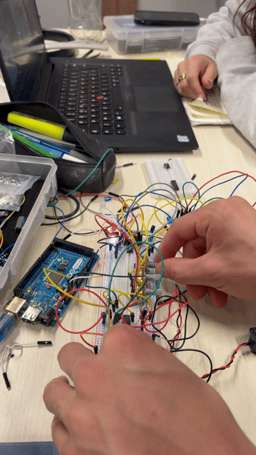</a></p>
<p align="center"><strong>Turn the controls. Observe the LEDs. Explore the recordings.</strong><br>The GIF is a silent, five-second excerpt. Open the full video for its recorded audio.</p>

| Breadboard demonstration | Control experiment | Close-up demonstration |
| :---: | :---: | :---: |
| [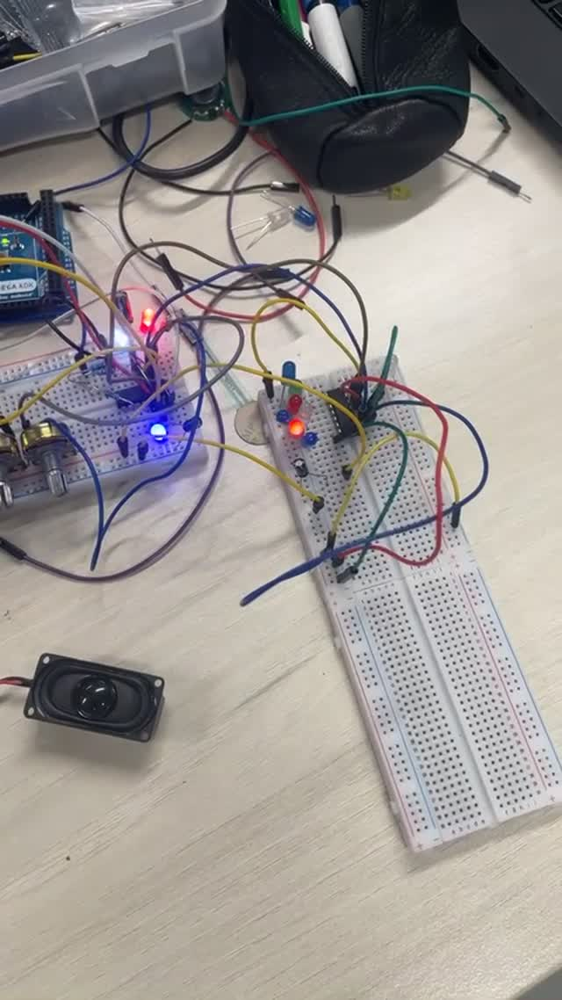](media/video/F5FD7321-8B4E-42B4-98F9-2C26B623B50A.mp4) | [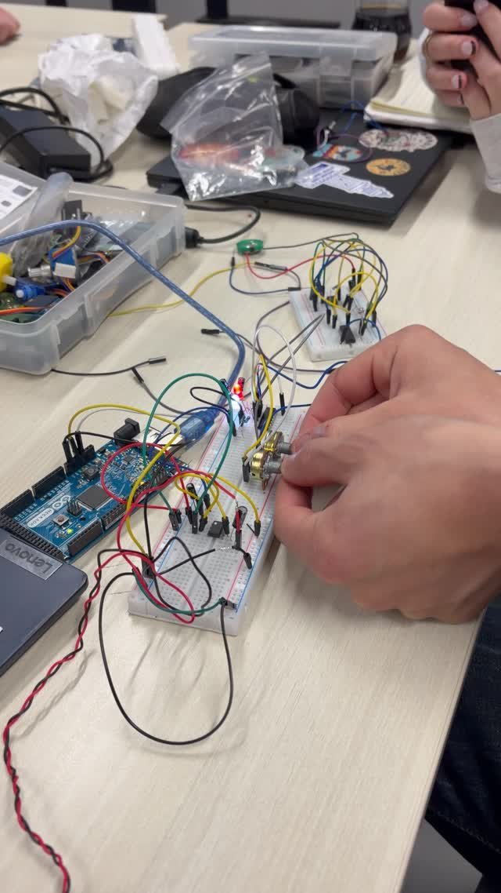](media/video/IMG_2965.mp4) | [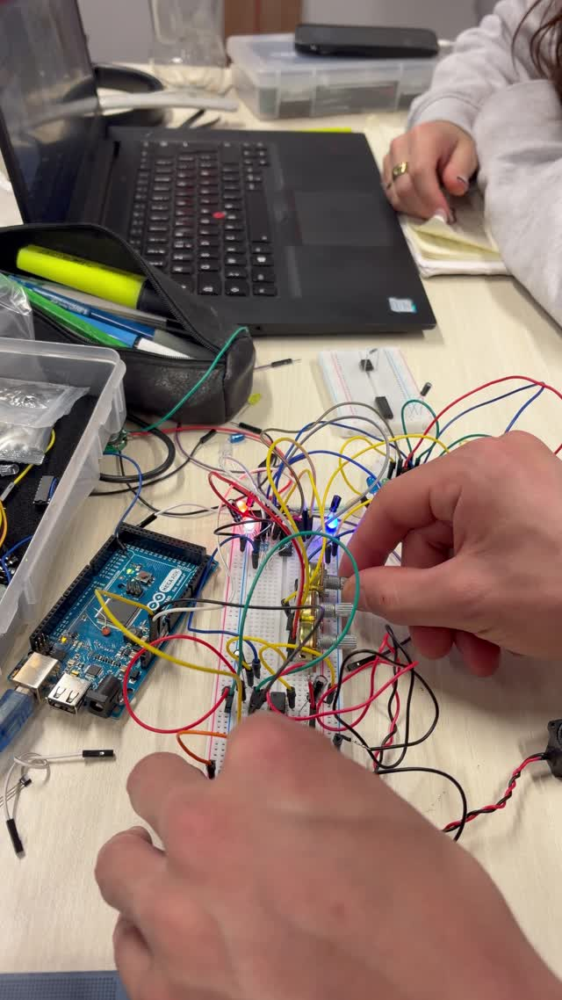](media/video/IMG_2967.mp4) |
| **39.3 s** · [Watch video](media/video/F5FD7321-8B4E-42B4-98F9-2C26B623B50A.mp4) | **13.0 s** · [Watch video](media/video/IMG_2965.mp4) | **16.5 s** · [Watch video](media/video/IMG_2967.mp4) |
| [Listen / download audio](media/audio/F5FD7321-8B4E-42B4-98F9-2C26B623B50A.m4a) | [Listen / download audio](media/audio/IMG_2965.m4a) | [Listen / download audio](media/audio/IMG_2967.m4a) |

The audio files are the original AAC tracks extracted from the supplied videos, without added sound or processing. They are recordings of the surrounding scene, not calibrated electrical measurements or direct line-output recordings. If a media file does not play in the repository viewer, download it to play locally.

## Breadboard experiments

The photographs document two visible arrangements: a compact setup with a light-dependent resistor, LED and speaker, and a longer breadboard with several rotary controls. The exact circuit revision associated with each recording remains to be matched to the forthcoming hand-drawn and TinkerCAD diagrams.

### 01 · Compact prototype

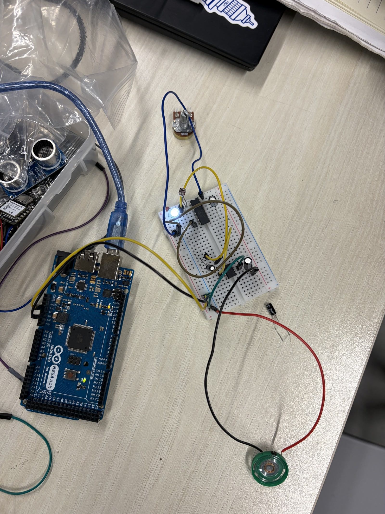

A photoresistor, illuminated LED, external potentiometer and small speaker are visible. An Arduino Mega ADK is also present in the setup; no firmware is supplied, so its exact role is not asserted here.

### 02 · Adjustable controls

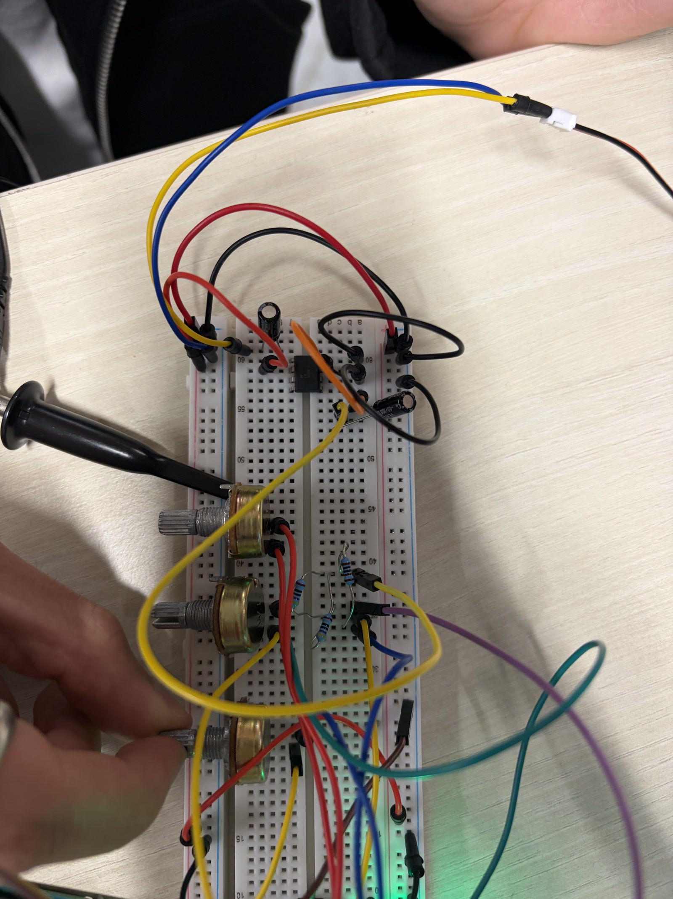

The larger prototype exposes multiple potentiometers for hands-on adjustment. This photograph records the physical arrangement of the controls and wiring.

### 03 · Circuit detail

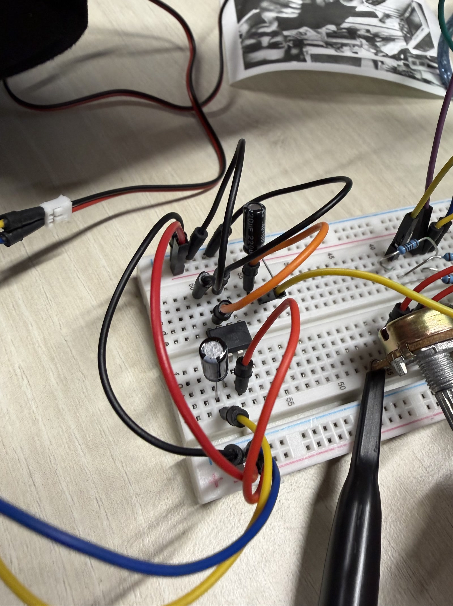

A closer view records the integrated circuit and capacitor area. Component values and connections should be read from the design files and forthcoming circuit diagrams, rather than inferred from the photograph alone.

## Circuit documentation

| Document | Status | Location |
| --- | --- | --- |
| Hand-drawn circuit diagram | Included | [Hand-drawn circuit](docs/hand-drawn/Hand-drawn.jpeg) |
| Oscilloscope screenshots | Awaiting upload | [Oscilloscope folder](docs/oscilloscope/) |
| TinkerCAD breadboard diagram | Awaiting upload | [TinkerCAD folder](docs/tinkercad/) |
| TinkerCAD generated schematic | Awaiting upload | [TinkerCAD folder](docs/tinkercad/) |
| KiCad schematic | Included | [Editable schematic](hardware/kicad/AlienSound.kicad_sch) · [SVG preview](docs/exports/AlienSound.svg) |

For each oscilloscope capture, the final documentation should identify the circuit version, probe point, volts/division, time/division and control setting. No measured frequency or amplitude is claimed without those measurements.

### Hand-drawn circuit

[](docs/hand-drawn/hand-drawn-circuit-v1.jpg)

*Hand-drawn schematic by Zoé, Raphaël and Clarisse (breadboard version 1).*

The drawing shows three blocks:

- **Clock and data oscillators (top right):** two 74HC14 Schmitt-trigger inverters (pins 1→2 and 3→4),
  each set up as a relaxation oscillator with a 10 kΩ potentiometer in the feedback path and a 10 µF
  capacitor to ground. One output goes to the SER input of the 74HC595, the other to its clock
  inputs (SRCLK and RCLK, tied together). OE is grounded and SRCLR is held at 5 V.
- **LED register (centre):** the 74HC595 drives LEDs to ground from its outputs. Three outputs
  are also connected through diodes to the inputs of the audio oscillators below.
- **Audio oscillators and amplifier (bottom):** three more 74HC14 inverters (pins 11→10, 13→12, 9→8),
  each again an RC oscillator with a 10 kΩ potentiometer and a 10 µF capacitor. Their outputs are mixed
  through three 1 kΩ resistors, passed through a 10 µF coupling capacitor to the LM386 (5 V supply),
  and sent to the speaker through a 22 µF capacitor.

## Soldered synth

**Photographs and proof of operation are still to be added.** The current gallery shows solderless breadboards and is not presented as evidence of a completed soldered circuit.

The final entry will include the component side, the solder side and a recording that shows the assembled circuit operating while its controls are adjusted. See the [soldered-build documentation](docs/soldered/).

## KiCad design

### Editable source files

- [AlienSound.kicad_pro](hardware/kicad/AlienSound.kicad_pro) — KiCad project.
- [AlienSound.kicad_sch](hardware/kicad/AlienSound.kicad_sch) — schematic, including embedded symbols.
- [AlienSound.kicad_pcb](hardware/kicad/AlienSound.kicad_pcb) — placed components, copper routing and board outline.
- [Component inventory](hardware/bom.csv) — references, values and footprints exported from the supplied schematic.

The files were created with **KiCad 10.0** and the previews were exported using **KiCad CLI 10.0.6**. Open the `.kicad_pro` file in KiCad 10 or a compatible later version, then launch the schematic or PCB editor.

### Schematic

[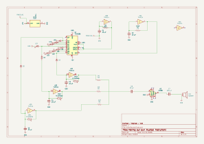](docs/exports/AlienSound.svg)

The source design contains three main ICs:

| Reference | Component | Position in the design |
| --- | --- | --- |
| U2 | 74HC14 | Several inverter sections connected to resistor/capacitor networks and the adjustable branches |
| U1 | 74HC595 | Eight outputs connected to LEDs; three also connect through diodes to adjustable branches |
| U3 | LM386 | Audio-stage IC, with output connected through C7 to the speaker connector LS1 |

This is a structural reading of the supplied schematic, not a statement that every connection has been electrically validated. The [design notes](docs/design-notes.md) record specific points to review before fabrication.

### 3D board previews

These KiCad 3D views show the component placement and overall appearance of the designed PCB.

**Top view**

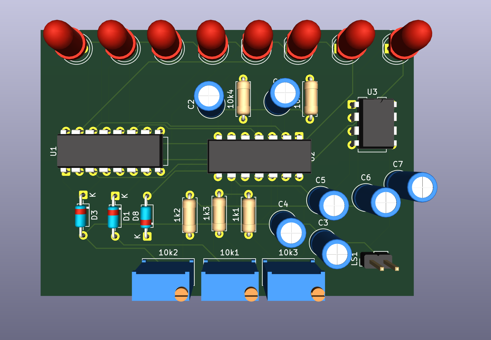

**Perspective view**

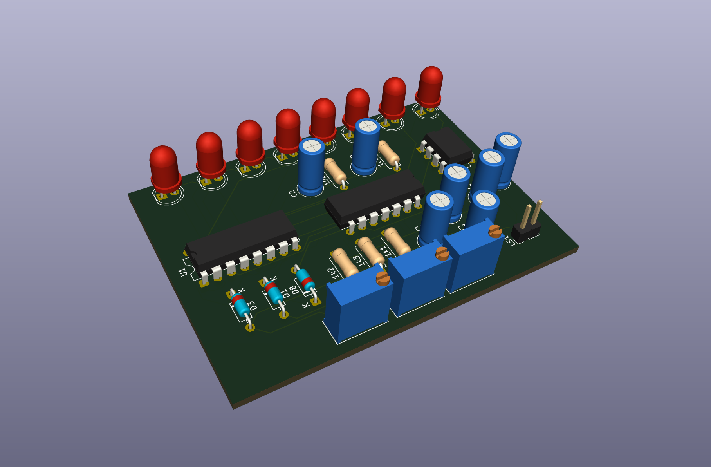

### Physical layout

[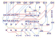](docs/exports/pcb-layout.svg)

| Property | Supplied PCB |
| --- | --- |
| Board outline | **70 × 50 mm**, measured between the Edge.Cuts centre lines |
| Nominal thickness | **1.6 mm** |
| Copper layers | **2** — F.Cu and B.Cu |
| Footprints | **30** |
| IC packages | DIP-16, DIP-14 and DIP-8, each with 7.62 mm row spacing |
| Controls | Three Bourns 3296W vertical trimmer footprints |
| Speaker connection | Two-pin header, 2.54 mm pitch |

The layout uses real component footprints. The trimmer footprints in the PCB are different from the large rotary potentiometers visible in the breadboard photos; the final component choice and mechanical fit therefore need confirmation.

### Version 2 development

The supplied KiCad project includes an eight-LED output section and three diode-connected adjustable branches. Its schematic and physical layout are available above.

**The version 2 comparison is to be completed.** This section is reserved for the baseline soldered circuit, the version 2 feature description, the corresponding circuit changes and demonstration.

## Documentation checklist

| Required evidence | Progress |
| --- | --- |
| Breadboard photographs | Included — 3 photographs |
| Breadboard video / GIF documentation | Included — 3 videos and 1 animated excerpt |
| Audio recordings | Included — 3 audio tracks extracted from the videos |
| Hand-drawn circuit | Pending |
| Oscilloscope screenshots | Pending |
| TinkerCAD breadboard diagram and generated schematic | Pending |
| Completed soldered circuit photographs | Pending |
| Proof that the soldered circuit functions | Pending |
| KiCad schematic and physical board layout | Included — editable source files and SVG previews |
| Explanation of the novel functionality in version 2 | To be completed |

## Repository map

```text
AlienSound/
├── README.md
├── hardware/
│   ├── kicad/          Editable project, schematic and PCB
│   └── bom.csv         Component inventory from the schematic
├── media/
│   ├── photos/         Three breadboard photographs
│   ├── video/          Full demonstrations with their audio
│   ├── audio/          Audio-only versions of the recordings
│   └── previews/       Video stills and animated excerpt
└── docs/
    ├── exports/        KiCad schematic, PCB preview and title graphic
    ├── hand-drawn/     Hand-drawn circuit documentation
    ├── oscilloscope/   Measurement captures
    ├── tinkercad/      Breadboard diagram and generated schematic
    ├── soldered/      Assembly photographs and operating proof
    ├── design-notes.md
    └── media-index.md  Source filenames and preparation notes
```

## Adding the remaining documentation

Place each new file in its matching folder, replace the corresponding “Pending” entry with a link, and add a caption explaining what the image or recording demonstrates. Keep the original breadboard, soldered version and extended PCB version clearly identified so that the development of the instrument can be followed.

---

*AlienSound — Making our own musical instrument. Project credits follow the supplied KiCad title block: Clarisse / Raphael / Zoé.*
